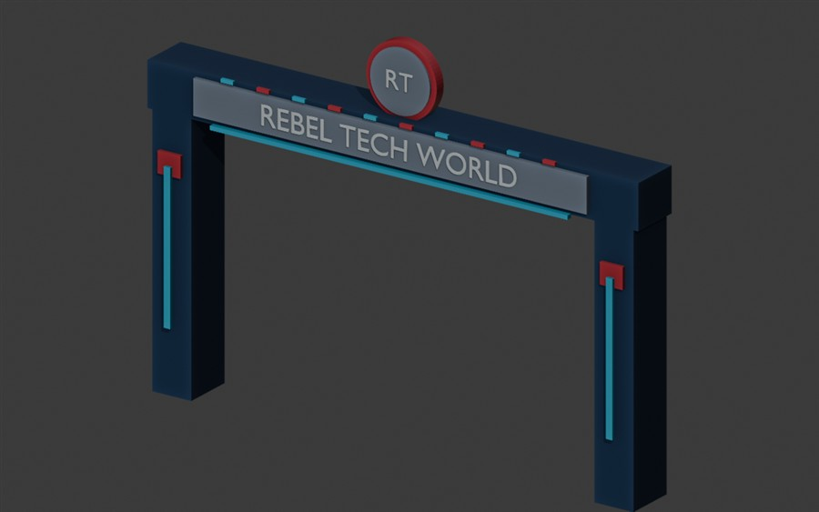
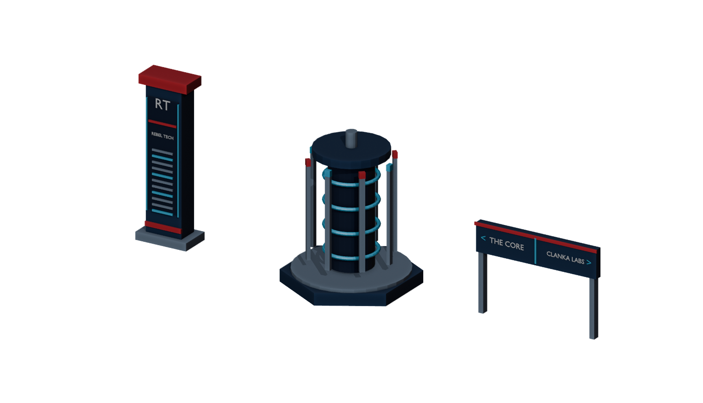

# Rebel Tech World — Planet Coaster 2

**Rebel Tech World** is a community creative project to design and build a playable, technology-themed amusement park in **Planet Coaster 2** on the Windows PC **Raven**.

> **Build status (2026-10-27): Game CLOSED cleanly on Raven at owner's request.** Three verified PC2 park saves remain, with backups on D:. The entrance boulevard and T-junction are built; the first 360 Power ride is placed but not operational (queue connection and electricity outstanding). Separately, an original three-piece Blender entrance scenery kit has been generated, GLB round-trip validated, and published to GitHub as OFFLINE candidates, not yet imported into PC2.

## Vision

An immersive technology-themed park inspired by Rebel Tech Oxford's **CONNECTING. INSTALLING. SOLVING.** identity: deep navy, red, white, illuminated circuits, robotics, networks, and server-room architecture. The goal is an actual playable park, not just renders, with working rides, paths, queues, shops, facilities, lighting, and scenery.

### First prototype: Rebel Tech World Gateway



*Original procedural Blender preview from the PC1 prototype. Its geometry and source assets can be adapted for PC2, but the old Toolkit ZIP is not a PC2 package. This is not an in-game screenshot.*

### PC2 modular entrance scenery kit — offline model candidates



Generated on Raven with Blender 4.5.3: **RT Fiber Pylon** (1,496 triangles), **RT Data Core** (3,232 triangles), and **RT Wayfinding Sign** (1,996 triangles). All three GLBs passed a clean Blender import validation. The original source generator and model binaries are available at [assets/pc2/entrance-kit-v0.1](assets/pc2/entrance-kit-v0.1/README.md). **No community model import tools have been installed; the assets are not yet visible in PC2.**

### Proposed districts

| District | Concept | Potential signature attraction |
| --- | --- | --- |
| **The Core** | Main gate, central promenade, towering data-center landmark | Server Crash coaster |
| **Overclock District** | CPUs, performance computing, neon cooling systems | The Overclock launched coaster |
| **Clanka Labs** | Robotics and automated factories | Fetchin' Clanka: Factory Escape dark ride |
| **Cyber City** | Gaming, terminals, arcades, digital infrastructure | Kernel Panic drop tower |
| **Power Grid** | Industrial power, electrical systems, kinetic energy | Energy-themed thrill attractions |
| **Signal Gardens** | Quieter landscaping and network-themed paths | Family rides and scenic areas |
| **Cooling Loop** | PC2 water park, pools, slides and liquid cooling theme | Cooling tower flumes and lazy river |

Names, layout, and ride details are proposals subject to gameplay testing.

## Target environment

- **Game:** **Planet Coaster 2** for Windows, sandbox mode. Installed on D:, launched successfully on Raven and vanilla park save/reload verified.
- **Host PC:** Raven; Windows 11 Pro, inspected October 27, 2026.
- **Workspace:** `D:\RebelTechWorld` to reduce use of C:; check capacity before setup. Game/system caches and saves may still occupy C:.
- **3D authoring:** Blender 4.5.3 LTS confirmed. Preserve old gateway source and adapt a standalone model for PC2.
- **Official content sharing:** PC2 uses Frontier Workshop for built-in blueprints and parks. PC1's Thememaker's Toolkit and .pcugc pipeline are **legacy only**. For custom model imports, evaluate optional third-party KMods Converter with ACSE/ForgeUtils after version/security review and save backups; see [PC2 pipeline](docs/PC2_PIPELINE.md).
- **Automation:** Authorized local desktop controls and deterministic scripts where practical; screenshot-driven inspection and manual checkpoints.
- **Knowledge hub:** [Rebel Tech World — Notion project hub](https://app.notion.com/p/4066b61e436e8102931fe868f8ac2ee3?pvs=204).

## Project principles

1. **Playable first.** Favor working rides and safe guest navigation over impressive but nonfunctional mockups.
2. **Validate the pipeline.** Build and import one small custom scenery piece before designing dozens.
3. **Checkpoints and backups.** Save, reload, and verify incremental builds; don't alter undocumented proprietary save formats.
4. **Reproducible construction.** Keep source assets, scripts, documented dependencies, and build procedures under version control.
5. **Protect disk space.** Keep large temporary exports on D: when configurable; do not commit installed game files or Steam assets.
6. **Measured automation.** Prove mouse/keyboard control before assuming unattended construction is feasible.
7. **Evidence over claims.** Label designs as proposed, work as in-progress, and tests as passed only once verified.

For phased construction, see [PC2 Build Phases](docs/BUILD_PHASES.md); for the broken ride queue and power routing, see [Ride & Utilities Runbook](docs/RIDE_AND_UTILITIES_RUNBOOK.md).

## Initial milestones

- [x] Connect to Raven with permission and inspect C:/D: available space, Planet Coaster, Blender, and build prerequisites. (C: 22.6 GiB free; D: 316.7 GiB free.)
- [x] Create the local `D:\RebelTechWorld` workspace and Git clone.
- [x] Create original scenery in Blender; export and verify **PC1-format** FBX/ZIP offline (retained solely as reusable source).
- [x] Install and launch **Planet Coaster 2** on Raven; create/save/reload a vanilla sandbox park.
- [x] Export a single-object Blender/GLB gateway **candidate** and validate in Blender: 6,520 triangles, five materials, 7.55 × 0.86 × 5.54 m, 265,936-byte GLB; game import still outstanding.
- [ ] Review optional community KMods Converter / ACSE / ForgeUtils for security, game-version compatibility and backups; test custom scenery only if approved.
- [x] Create and validate safe, foreground-verified mouse/keyboard/screenshot automation on Raven (`scripts/pc2_desktop_control.py`); build a straight 8m guest path and T-junction. The visual/scenery-heavy entrance plaza remains to be designed.
- [x] Save and reload the original vanilla sandbox park; create two further save checkpoints and SHA-256-verified backups on D:.
- [ ] Complete ride entrance queue, exit connection and power for built-in 360 Power flat ride; open and test it in-game.
- [ ] Create a measured construction roadmap for all districts, including **Cooling Loop** waterpark.

## Planned repository structure

```text
rebel-tech-theme-park/
├── README.md
├── AGENTS.md             # Agent coordination and safety conventions
├── docs/                 # Architecture, runbooks, park layout, build log
├── scripts/              # Reproducible local automation / export helpers
├── blender/              # Editable original Blender source assets
├── assets/               # Original, license-safe asset inputs
└── .gitignore            # Local caches, saves, exports and secrets
```

The source Blender generator, offline validator, Windows preflight script, agent instructions, **PC2 pipeline**, PC1 legacy Toolkit runbook, and build log now exist. Further project folders are added as needed.

## Agent collaboration

**ChatGPT, Claude, and Grokbot** may contribute via normal GitHub workflows when independently connected and granted access. Do not assume that another agent sees local changes or can access this repository automatically.

For every work session, document:
- What changed, by whom, and which commit or branch contains it.
- Screenshots, imports, tests, or save/reload evidence, as applicable.
- Outstanding blockers, relevant versions, and the next safe action.

**Preferred workflow:** create a focused branch for substantial changes, commit source and docs, request review, and merge after validation. The repository and Notion hub should tell the same story.

## Important: PC1 legacy work

The prior `docs/TMT_PIPELINE.md` and scripts creating `.pcugc` upload ZIPs were made for PC1 and remain as historical/reference work. **Do not run a PC1 Toolkit conversion as part of the active PC2 setup.** The original Blender gateway geometry and preview remain useful.

## Getting started

For offline scripting, design and model development, keep **Planet Coaster 2 closed** as requested. Relaunch only when an active in-game construction or validation step requires it, after checking Raven access and existing saves. Resume from the latest safe in-game checkpoint **Ride Test 02** and use [Ride & Utilities Runbook](docs/RIDE_AND_UTILITIES_RUNBOOK.md).

---
Rebel Tech Oxford — **CONNECTING. INSTALLING. SOLVING.**

This is an independent fan-made creative project, not affiliated with or endorsed by Frontier Developments or Planet Coaster.
