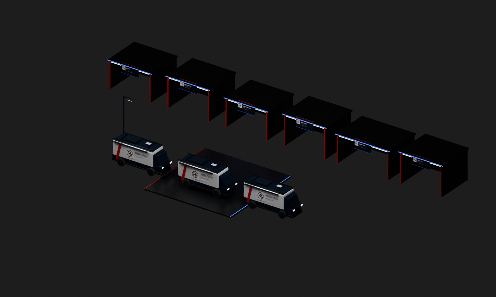

# Rebel Grid v1 — original scenery prototypes and native billboard images

**Status: offline Blender/GLB prototypes validated; native image files staged. These GLBs are NOT installed Planet Coaster 2 scenery.**



## Models

| File | Triangles | Purpose |
| --- | ---: | --- |
| rt_mobile_workshop_van.glb | 5,728 | Simplified original high-roof long-wheelbase workshop van based on the owner's visual references. Roof rack, awning cassette, original RT circle texture, red/navy/white wrap and black wheels. Not an exact Mercedes model. |
| rt_pure_white_streetlight.glb | 444 | Pure-white emissive fixture prototype. This does not automatically create a functioning PC2 illumination source. |
| rt_large_grid_paving_module.glb | 72 | 12m square charcoal paving with red/blue edge strips; larger repeating modules reduce scenery overhead. |
| rt_shell_food.glb | 482 | BYTE BITE custom front-open building shell. |
| rt_shell_cafe.glb | 482 | OVERCLOCK CAFE shell. |
| rt_shell_toilets.glb | 482 | REBOOT RESTROOMS shell. |
| rt_shell_shop.glb | 482 | CACHE & CARRY shell. |
| rt_shell_restaurant.glb | 482 | CORE KITCHEN shell. |
| rt_shell_service.glb | 482 | PATCH BAY shell. |

All nine passed a clean-scene Blender 4.5.3 GLB re-import with matching triangle counts. The combined .blend and render remain under build/pc2/rebel-grid/models on Raven's D: drive. The overview shows three instances of ONE shared van mesh. **Zero custom vans have been placed in PC2.**

The six shells are first-pass structural prototypes, not finished individual buildings. Keep the entry opening clear, fit the functional game facility inside, and validate guest access. No counter, restaurant simulation or toilet simulation is encoded in these GLBs.

## Billboard images

The media/ folder contains seven 1280x720 signs built around the owner's exact RT circle artwork. scripts/stage_grid_media.ps1 generated them on D: and copied them plus two original images into PC2 UserMedia, verifying all nine hashes.

**Staged does not mean placed.** A TV Screen 4m selection/placement experiment was interrupted when another supervised session took the PC2 desktop lease for path repairs. No assigned custom-image billboard or saved logo placement is verified yet.

## Reproduce

From the repo on Raven:

```powershell
& .\scripts\stage_grid_media.ps1
& 'C:\Program Files\Blender Foundation\Blender 4.5\blender.exe' --background --threads 4 --python .\blender\build_rebel_grid_kit.py
```

Pure white: #FFFFFF. Accent red: #E10616. Accent BLUE: #244CFF, not cyan. Dark navy #061A33 and charcoal #090B10.

## Integration gates

Prefer native PC2 billboards for image logos and native scenery construction for game-ready shells/vehicles. A GLB may serve as an exact visual construction reference. Optional custom-model converter paths are third-party and still unreviewed; do not install them silently or assume Frontier Workshop compatibility.

The Mombasa recording is not part of this package. No music was downloaded or purchased. Use a lawfully obtained local file and do not redistribute it in GitHub or a park download.

See ../../../docs/REBEL_GRID_MASTERPLAN.md for all ride, branding and art-direction requirements. Brand ownership remains with the owner; no blanket reuse license is implied.
