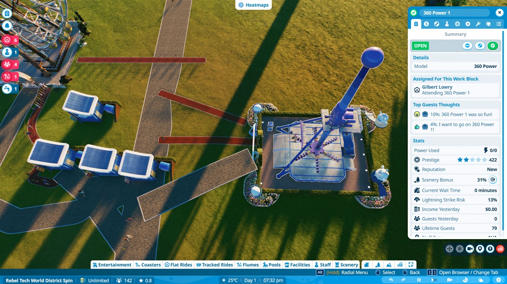

# Desktop-resume construction and audit — October 27, 2026

**Status: entrance-path progress, not a completed functional district. Exit warnings remain.**

## Scope and coordination

The owner requested that this desktop conversation perform the actual Planet Coaster 2 work through Desktop Commander on Raven, after reading the latest Notion handoff. The previous repair session handed over without resetting the game. Later the owner's newer coaster/long-queue session acquired control; this session acknowledged that transfer and stopped GUI input. The unsaved park state was explicitly handed over instead of being discarded.

## 360 Power — verified entrance repair and served guests

- Inspected the existing closed ride from above after correcting camera rotation with bounded relative mouse events.
- Located the actual entrance gate and built a native queue: a short outward segment, then a valid join into the guest avenue.
- The entrance-access warning cleared, the ride opened and an attendant was assigned.
- Guests entered the queue; the ride was seen operating at different cycle positions. Lifetime Guests increased from 0 to 11, then 79. The ride panel displayed positive post-ride feedback: '360 Power 1 was so fun!'.
- A distinct checkpoint was saved and reloaded through the native Load Park menu. The queue, OPEN state and 79 served guests survived reload.
- **Important correction:** the normal 5m exit-path attempt LOOKED joined, but a later notification audit still reported that the park entrance was inaccessible from the ride exit. Therefore exit/root-network validation has NOT passed. The served counter, OPEN label and successful reload are not proof of a working exit. An exact three-cycle boarding-and-exit acceptance audit is not claimed.

## Teacups — local entrance passes, not yet guest-tested

- Constructed an 8m normal guest approach branching southeast from the existing upper junction.
- Attached a short queue from the actual entry gate, then attempted a separate 5m normal exit connector.
- The local entrance warning cleared; the ride opened with an attendant.
- Teacups remained at ZERO lifetime guests during observation. The notification audit continued to report its exit could not reach the park entrance.
- The faulty rectangular exit stub was partly removed with the native Delete Brush (size 3), followed by a Classic Paths gate-snap attempt. A wedge-shaped connector is visible, but its graph connectivity is unverified.
- These Teacups changes were UNSAVED at handoff to the newer coaster-queue session. That session was explicitly told to Save As before changing anything or reloading.

## Checkpoints preserved on Raven

These are private game saves, not GitHub assets. Backups use separate timestamped directories under ignored build/backups/pc2/desktop-resume-20261027.

| Checkpoint | Bytes | SHA-256 | Evidence |
| --- | ---: | --- | --- |
| RT Grid Resume 09-AC0D91EF.park2 | 4,578,353 | a10da4fce13fe0ca48124734492c06bb45c1591cfc9465c4d23aa73892d3b4be | Preserved handoff state before this session's new repairs; D: copy matched. |
| RT Grid 360 Access 10-D83FA017.park2 | 4,610,796 | 0bd0c78d8c4defcb879f38fde42189f41deebc774240258b5c8facb4aceafeab | 360 entry repaired and 79 served; D: copy matched; native reload passed; exit warning unresolved. |

The earlier RT Grid Access 08 was also backed up. The prior repair session documented Star Wheel serving 100 guests; this session preserved that repair and does not claim authorship.

## Outstanding ride-access warnings at final audit

1. Park entrance not accessible from exit of 360 Power 1.
2. Park entrance not accessible from exit of Teacups 1.
3. Sky Watcher 1 entrance not connected to any path.
4. Park entrance not accessible from exit of Sky Watcher 1.
5. Park entrance not accessible from exit of THE OVERCLOCK.

None of those notifications were dismissed or disabled. The next controller has been warned not to mark them resolved based on OPEN alone. A possible disconnected public-network segment and/or incorrect gate-height snap needs investigation; this is a diagnostic hypothesis, not an established cause.

## Tested camera helper

scripts/pc2_camera_step.py performs one bounded relative mouse-camera movement using the existing exact-process and cooperative-ownership checks. Arguments are validated; mouse buttons are released in a finally block. Live overhead camera rotation and syntax validation passed. Positive vertical middle-button movement tilts toward an overhead construction view. It is a supervised tool, not an unattended gameplay loop.

## Remaining constraints

- Orphan queue stubs near the original avenue remain and require deliberate cleanup.
- Power requirements were already disabled (0/0) before this session. No generator/distributor network was built.
- Guest-needs, staffing, pool operations, RT logo placement, custom building exteriors and grass removal remain unfinished.
- No new rides, mods, paid DLC, proprietary save edits, or music downloads were made in this repair session.
- The current control owner is recorded in the local coordination lease. Do not run parallel game inputs, reset the park, or close it during another authorized construction session.